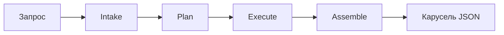
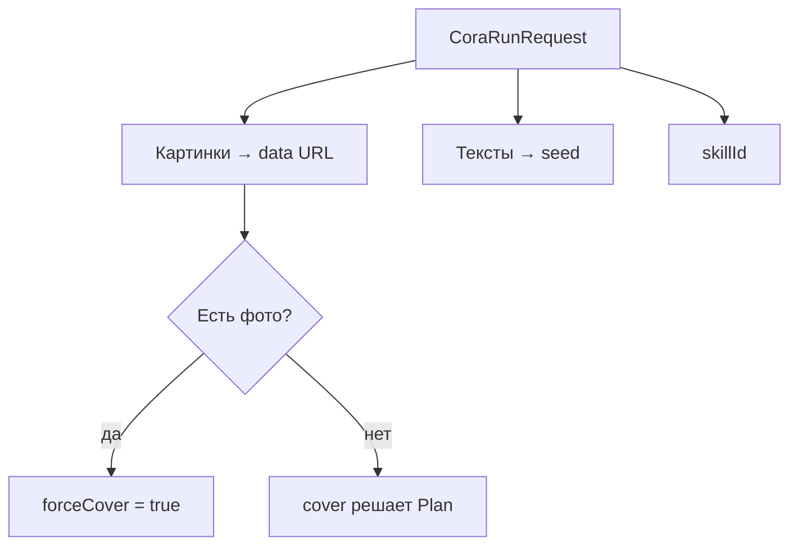
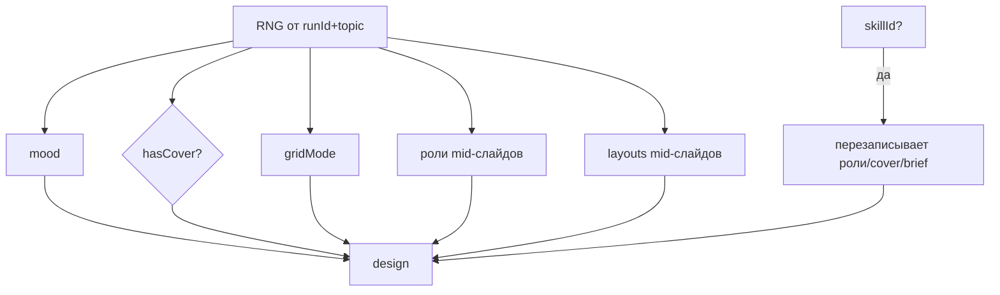
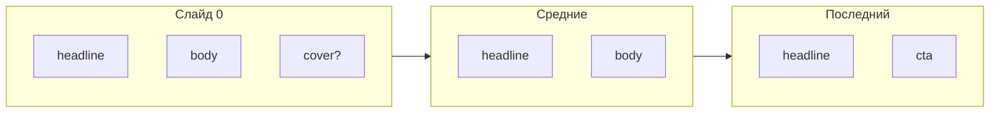
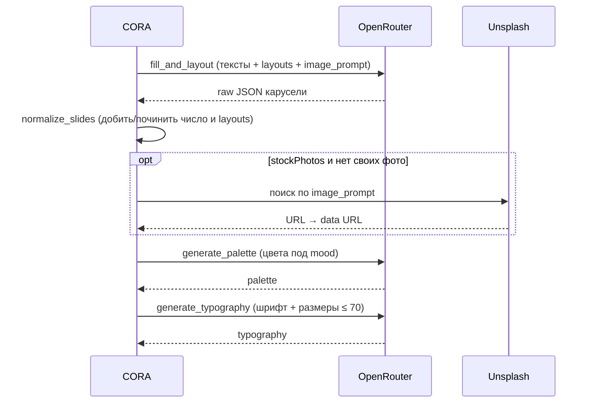
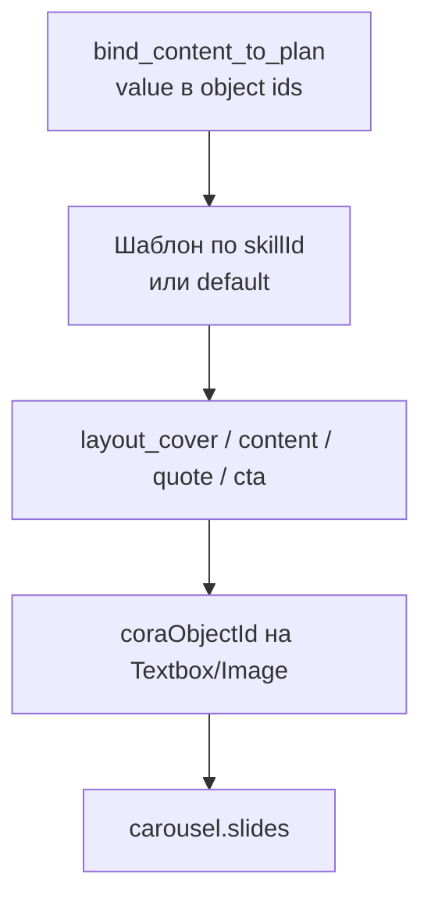

# CORA — как работает генерация карусели

**CORA Fast** = один запрос → готовая Fabric-карусель.  
Все LLM-вызовы идут через **OpenRouter**. Биллинг снаружи (Next.js).

Точка входа: `POST /cora/run` → `run_cora_fast()`.

---

## Большая картина



| Фаза | Что делает | LLM? |
|------|------------|------|
| **Intake** | Читает тему, фото, skill, handle | нет |
| **Plan** | Решает структуру слайдов и mood | нет (рандом от runId); у `aesthetic` — engine=aesthetic_llm |
| **Execute** | Пишет тексты, палитру, шрифт; ищет фото | да |
| **Assemble** | Собирает Fabric-слайды по шаблону | нет; у `aesthetic` — из LLM `elements[]` |

Статусы run: `planning` → `executing` → `assembling` → `done` / `failed`.

---

## 1. Intake — что пришло

Из запроса берём:

- тему, язык, ratio, число слайдов (1–10)
- `handle` + флаг `showHandle`
- обложку / картинки / текстовые заметки
- опционально `skillId`, `font`, `brandKit`, `stockPhotos`



- Картинки: cover / attachments → нормализуются в data URL.
- Тексты: `seedText` + text-attachments → один seed для копирайтера.
- Если есть любое фото или cover — обложка **обязательна**.

---

## 2. Plan — скелет карусели

Планировщик **не зовёт LLM**. Выбор детерминирован от `coraRunId + topic`.

### 2.1. Design



В `design` попадает:

- `hasCover`, `mood`, `gridMode`, `accentBias`, `photoRatio`
- `midRoles` / `midLayouts` — что делают средние слайды
- если задан **skill** — жёсткая структура (howto, myths, pricing…)

### 2.2. Skeleton plan

На каждый слайд создаются объекты с **стабильными id**:

```
s0_headline, s0_body, s0_cover?
s1_headline, s1_body
…
sN_headline, sN_body   ← последний = CTA
```



План = карта «какие слоты заполнить». Тексты пока пустые.

---

## 3. Execute — контент и визуал

Здесь работают модели.



### Тексты

1. В topic подмешиваются skill-brief и seed.
2. LLM возвращает `title`, `category`, `slides[]` (`layout`, `heading`, `body`, `items`, `image_prompt`…).
3. `normalize_slides` гарантирует:
   - ровно N слайдов
   - первый = cover (если `hasCover`) иначе не-cover
   - последний = `cta`
   - средние без случайного cover/cta

### Фото

Порядок приоритета:

1. Свои картинки пользователя  
2. Unsplash по `image_prompt` (если `stockPhotos=true` и есть ключ)  
3. Пусто → placeholder / текстовый слайд

Раскладка: `[0]` = cover, дальше mid-слайды, **CTA без фото**.

### Палитра и шрифт

- Палитра — свежие hex под topic + mood.
- Шрифт — из каталога `/fonts` (кириллица + латиница).
- Размер заголовка ограничен **70**.
- `showHandle=false` → хэндл не рисуется.

---

## 4. Assemble — Fabric JSON



1. Тексты из slides прописываются в plan-objects (`value`).
2. Берётся визуальный шаблон (`skillId` → registry, иначе default).
3. Каждый слайд собирается в Fabric-объекты (rect, textbox, image) с палитрой и типографикой.
4. На слои ставится `coraObjectId` = id из плана (`s0_headline` …) — чтобы клиент мог править объект точечно.
5. Опционально `save=true` → файл в `output/`.

Ответ API: `plan` + `objectBindings` + `palette` + `carousel`.

---

## Поток данных одной строкой

```text
тема + skill + фото
    → design (mood, cover, роли)
    → plan (слоты s*_headline / s*_body)
    → LLM тексты
    → фото (свои / Unsplash)
    → LLM палитра + шрифт
    → Fabric slides + coraObjectId
```

---

## Skills

`skillId` фиксирует **смысловую** структуру mid-слайдов и brief для копирайтера.

Примеры: `launch`, `howto`, `tips`, `myths`, `pricing`, `aesthetic`, `lookbook`…

Без skill — CORA сама кидает роли из пулов (hook / offer / proof / …).

### Ветка `aesthetic` (эксперимент)

При `skillId=aesthetic` CORA уходит в **отдельный engine** (`design.engine = aesthetic_llm`):

1. Plan почти не диктует layout/mood-пулы (mood фиксируется как `pinterest_editorial`).
2. Execute зовёт отдельный промпт: модель сама придумывает композицию каждого слайда
   (`elements[]` в нормализованных координатах 0..1) — full-bleed + cream type + pills,
   2×2 collage, split seam, stack tips и т.п. (Pinterest aesthetic).
3. Assemble **не** берёт `AestheticTemplate` из registry — рендерит Fabric из `elements[]`.
4. Фото: несколько `image_prompts` на слайд → Unsplash по слотам collage/split.

Остальные skills по-прежнему: рандом design → тексты LLM → жёсткий OOP-шаблон.

---

## Что где в коде

| Кусок | Файл |
|-------|------|
| Оркестратор | `app/cora/runner.py` |
| Design + skeleton plan | `app/cora/plan.py` |
| Skills | `app/cora/skills.py` |
| Тексты LLM | `app/content.py` + `app/prompts.py` |
| Aesthetic / Pinterest LLM | `app/cora/aesthetic/` |
| Палитра | `app/palette.py` |
| Шрифты | `app/fonts.py` |
| Сборка Fabric | `app/cora/assemble.py` + `app/templates/` |
| Сток-фото | `app/stock_photos.py` |

---

## Коротко

CORA сначала **жёстко планирует каркас** (без LLM), потом **трижды зовёт модель** (тексты → цвета → шрифт), подкладывает фото и **собирает** готовые слайды так, чтобы каждый текст имел стабильный object id.
